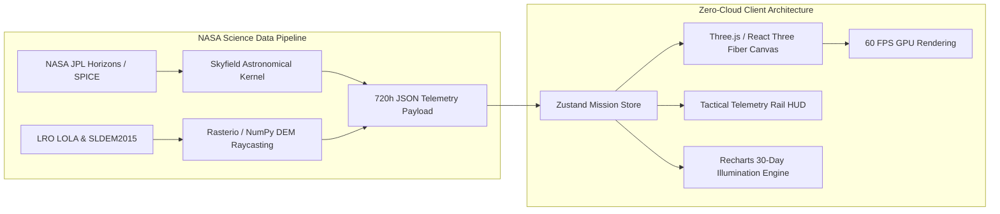

# 🌕 CLPS Lunar Mission Browser
### Next-Generation 3D Cislunar Orbit & South Pole Surface Telemetry Digital Twin

[](https://clps-lunar-mission-browser-hackatho.vercel.app/)
[](https://www.spaceappschallenge.org/)
[](https://react.dev/)
[](https://threejs.org/)
[](https://www.typescriptlang.org/)
[](https://ssd.jpl.nasa.gov/)
[](https://tailwindcss.com/)
[](LICENSE)

> 🚀 **Live Web Application:** [https://clps-lunar-mission-browser-hackatho.vercel.app/](https://clps-lunar-mission-browser-hackatho.vercel.app/)  
> *Explore real-time 3D cislunar orbits, LOLA DEM surface altimetry, and 720-hour mission telemetry directly in your browser on desktop and mobile.*

---

## 🔭 Executive Overview

At the lunar South Pole, the Sun skims the horizon at extreme grazing angles of **$0^\circ \text{ to } 2^\circ$**, casting **50-kilometer-long shadows** across crater floors that have remained in complete darkness for over two billion years. These **Permanently Shadowed Regions (PSRs)** plunge to **$40\text{ Kelvin } (-233^\circ\text{C})$** and trap billions of tons of ancient water ice—humanity's primary propellant depot for Mars and sustained deep-space exploration.

However, operating a robotic lander at the South Pole poses a severe **survival paradox**:
* Landers must stay close to dark cold traps to access cryogenic water ice.
* Landers must remain on razor-thin elevated crater rims to receive sunlight for solar power and maintain **Direct-to-Earth (DTE) radio links**.
* A landing error of just a few hundred meters can mean landing in a permanent shadow, resulting in rapid battery freeze-out and mission loss within hours.

**CLPS Lunar Mission Browser** is an interactive, browser-based digital twin engineered for NASA's **Commercial Lunar Payload Services (CLPS)** initiative and the **Artemis program**. It unifies authentic **NASA JPL DE421 planetary ephemeris**, **LRO LOLA 5m/px laser altimetry**, **Diviner thermal radiometer measurements**, and **deterministic battery net-power physics** across **14 candidate landing sites**.

---

## 🚀 Key Capabilities

### 1. 🎛️ Tactical Flight Console (Pro Mode)
* **Real-Time 3D LOLA DEM Terrain:** High-performance WebGL terrain rendering featuring dynamic grazing sunlight, real-time shadow casting, and subtle Earthshine/starlight ambient illumination during lunar night.
* **30-Day Mission Scrubber:** Scrub across all **720 sequential hours** of the lunar synodic month to immediately visualize shadow creep, eclipse windows, and DTE communication blackouts.
* **Live Telemetry Rail:** Dynamic indicators for:
  * **Sun Elevation ($\alpha_\odot$) & Azimuth ($\theta_\odot$)**
  * **Direct-to-Earth Line of Sight (LOS Comm Link)**
  * **Solar Irradiance ($\text{W/m}^2$) & Battery State-of-Charge (%)**
  * **Max Surface Temperature ($K$)** via Diviner DLRE models
  * **LOLA Micro-Relief Slope Hazard ($<15^\circ$ tipping threshold)**
  * **Volatile Water Ice Retention (ISRU %)**

### 2. 🎓 Educator Mode (STEM for the Artemis Generation)
* **One-Click Translation:** Converts dense aerospace parameters into plain-English, intuitive insights for students and classrooms:
  * *Sun Elevation Angle* $\rightarrow$ **Sunlight Availability** (*"Can solar panels catch light?"*)
  * *Earth LOS Elevation* $\rightarrow$ **Radio Call to Earth** (*"Can we phone home to mission control?"*)
  * *Terrain Slope Angle* $\rightarrow$ **Landing Safety** (*"Will the lander tip over on touchdown?"*)
  * *Water Ice % (ISRU)* $\rightarrow$ **Rocket Fuel & Drinking Water** (*"Resources for Mars!"*)
* **Contextual Explanations:** Hoverable tooltips, simplified badges, and interactive educational banners.

### 3. 📊 Multi-Objective Site Comparison Matrix (`/compare`)
* Cross-benchmarks all candidate South Pole locations against the equatorial baseline of **Apollo 11**.
* Demonstrates why the South Pole is essential: **Peaks of Light (Shackleton Rim & Malapert) offer 86%–92% continuous sunlight**, avoiding the brutal 14-day total blackout night experienced at the lunar equator.
* **Algorithmic MCDA Suitability Scorecard:**

$$\text{Suitability Score } S = 0.40 \cdot \left(\frac{T_{\text{sun}}}{720}\right) + 0.35 \cdot \left(\frac{\text{Comms } \%}{100}\right) + 0.25 \cdot \left(\frac{\min(I_{\text{avg}}, 50)}{50}\right)$$

### 4. 🛰️ Cislunar Flight Path & Trajectory Tracker
* Orbital visualization from Earth departure and LEO injection to trans-lunar cruise and orbital insertion waypoints.
* Interactive camera presets: `System Overview`, `Earth Departure`, `Cruise Tracker`, and `Lunar Orbit`.

---

## 🔬 Scientific Provenance & Traceability Matrix

In adherence to scientific integrity principles, every number displayed in the dashboard is strictly partitioned into verified observation, physical model, or simulated subsystem:

| Metric Name | Classification | Primary Scientific Origin | Traceability Label |
| :--- | :---: | :--- | :--- |
| **Sun Elevation & Azimuth** | `REAL` | NASA JPL DE421 + `MOON_PA_DE421` SPICE kernel | `[REAL: NASA SPICE]` |
| **Earth Elevation & Azimuth** | `REAL` | NASA JPL DE421 + Libration Topocentric Frame | `[REAL: NASA SPICE]` |
| **Terrain Heightmap & DEM** | `REAL` | NASA LRO LOLA & SLDEM2015 ($5\text{m} - 20\text{m/px}$) | `[REAL: NASA LOLA DEM]` |
| **Horizon Obstruction $h(\theta)$** | `REAL` | $360^\circ$ raycast horizon mask across LOLA DEM | `[REAL: LOLA RAYCAST]` |
| **Sunlight Duration (Hours)** | `REAL` | DE421 Ephemeris intersected with LOLA Horizon Mask | `[REAL: COMPUTED EPHEMERIS]` |
| **Comms Line-of-Sight (LOS)** | `REAL` | DE421 Ephemeris intersected with LOLA Horizon Mask | `[REAL: COMPUTED EPHEMERIS]` |
| **Solar Irradiance ($\text{W/m}^2$)** | `PHYSICAL MODEL` | ASTM E490 ($1361\,\text{W/m}^2$) $\times \sin(\text{effective elevation})$ | `[PHYSICAL MODEL]` |
| **Telemetry Comms Data Rate** | `SIMULATED` | NASA DSN Ka-band surface link budget model | `[SIMULATED LINK BUDGET]` |
| **Battery State of Charge (%)**| `SIMULATED` | $10\,\text{m}^2$ array (30% eff.), $50\,\text{W}$ load vs. $1000\,\text{Wh}$ cap | `[SIMULATED SUBSYSTEM]` |
| **Suitability Score** | `DERIVED` | Multi-Criteria Decision Analysis (MCDA) composite | `[DERIVED METRIC]` |

---

## ⚡ Deterministic Lander Power Physics

The lander's electrical power subsystem is modeled hour-by-hour sequentially across the entire 720-hour lunar month:

$$P_{\text{generated}} = I_{\text{solar}} \times A_{\text{array}} \times \eta_{\text{solar}} = I_{\text{solar}} \times 10\,\text{m}^2 \times 0.30$$

$$P_{\text{consumed}} = 50\,\text{W} \quad (\text{Lander base hotel load})$$

$$P_{\text{net}} = P_{\text{generated}} - P_{\text{consumed}}$$

$$\Delta B = \left(\frac{P_{\text{net}} \times 1\,\text{h}}{C_{\text{battery}}}\right) \times 100\% = \left(\frac{P_{\text{net}}}{1000\,\text{Wh}}\right) \times 100\%$$

$$B_{t+1} = \max\left(0.0\%, \min\left(100.0\%, B_t + \Delta B\right)\right)$$

* **During Daylight:** The $10\,\text{m}^2$ high-efficiency triple-junction array rapidly recharges the battery to 100%.
* **During Eclipses / Sunset:** Net power flips negative ($-50\,\text{W}$), draining the $1000\,\text{Wh}$ battery at **$5\%$ per hour**, accurately illustrating why long shadow passages cause mission-ending battery depletion.

---

## 🗺️ Candidate Landing Sites Evaluated (14 Sites)

| Site ID | Site Name | Latitude | Longitude | Primary Characterization |
| :--- | :--- | :---: | :---: | :--- |
| `shackleton` | **Shackleton Crater Rim** | $89.9^\circ\text{S}$ | $0.0^\circ\text{E}$ | Quasi-eternal light peak; adjacent to $40\text{K}$ volatile ice trap |
| `malapert` | **Malapert Mountain** | $84.9^\circ\text{S}$ | $12.9^\circ\text{E}$ | High ridge summit; exceptional Direct-to-Earth line-of-sight |
| `haworth` | **Haworth Crater** | $87.4^\circ\text{S}$ | $5.1^\circ\text{W}$ | Extreme cold trap with significant volatile concentrations |
| `de_gerlache` | **de Gerlache Rim** | $88.5^\circ\text{S}$ | $88.3^\circ\text{W}$ | Elevated rim plateau with high cumulative illumination |
| `nobile_rim` | **Nobile Rim 1** | $85.2^\circ\text{S}$ | $53.5^\circ\text{E}$ | VIPER mission candidate target area |
| `amundsen` | **Amundsen Rim** | $84.5^\circ\text{S}$ | $85.6^\circ\text{E}$ | Broad rim terrace offering stable landing slopes |
| `mons_mouton` | **Mons Mouton** | $84.6^\circ\text{S}$ | $30.0^\circ\text{W}$ | Flat mesa-like highland with moderate slope hazards |
| `cabeus_b` | **Cabeus B** | $82.4^\circ\text{S}$ | $53.1^\circ\text{W}$ | Proximate to historic LCROSS water plume impact site |
| `slater_plain` | **Slater Plain** | $88.1^\circ\text{S}$ | $112.5^\circ\text{E}$ | Low-slope highland plain suitable for cargo delivery |
| `im1_odysseus` | **Intuitive Machines IM-1** | $80.1^\circ\text{S}$ | $1.4^\circ\text{E}$ | Historic commercial CLPS landing (Malapert A region) |
| `chandrayaan_3` | **Chandrayaan-3 Shiv Shakti** | $69.4^\circ\text{S}$ | $32.3^\circ\text{E}$ | Historic ISRO high-latitude southern landing site |
| `change_4` | **Chang'e 4 (Von Kármán)** | $45.5^\circ\text{S}$ | $177.6^\circ\text{E}$ | Lunar Far Side South Pole-Aitken basin |
| `luna_9` | **Luna 9 (Oceanus Procellarum)**| $7.1^\circ\text{N}$ | $64.4^\circ\text{W}$ | First survivable robotic soft touchdown |
| `apollo_11` | **Apollo 11 (Mare Tranquillitatis)**| $0.7^\circ\text{N}$ | $23.5^\circ\text{E}$ | Equatorial baseline: 14-day night, 0% volatile ice |

---

## 💻 Tech Stack & Architecture



* **Frontend Framework:** React 18, TypeScript, Vite
* **3D Graphics & Shaders:** Three.js, React Three Fiber (`@react-three/fiber`), Drei (`@react-three/drei`)
* **Styling & HUD:** Tailwind CSS v4, Lucide React Icons
* **Data Visualization:** Recharts (30-day illumination & power curves)
* **Science Pipeline:** Python 3.11, Skyfield (DE421 Ephemeris), Rasterio (LOLA DEM Processing), NumPy
* **Optimization:** Zero server dependencies (100% client-side WebGL), dynamic device pixel ratio (DPR) throttling for 60 FPS mobile performance.

---

## 🛠️ Quick Start & Installation

### Prerequisites
* **Node.js** (v18.0 or higher)
* **npm** (v9.0 or higher)
* **Python 3.10+** *(optional, only needed if regenerating NASA telemetry)*

### 1. Clone the Repository
```bash
git clone https://github.com/joahan77/clps-lunar-mission-browser-hackathon.git
cd clps-lunar-mission-browser-hackathon
```

### 2. Install Frontend Dependencies
```bash
npm install
```

### 3. Start the Development Server
```bash
npm run dev
```
Open [http://localhost:5173](http://localhost:5173) in your browser.

### 4. Build for Production
```bash
npm run build
```
Creates a fully optimized, minified production build in `dist/`.

---

## 🐍 Regenerating Telemetry Data (Python Pipeline)

If you wish to recalculate the 720-hour ephemeris and battery physics from scratch:

```bash
# 1. Install Python science dependencies
pip install skyfield rasterio numpy pillow

# 2. Run the multi-site telemetry generator
python generate_multi_site_telemetry.py
```
This updates all 14 site profiles in `public/*_data.json` with synchronized solar vectors, Earth line-of-sight angles, and battery states of charge.

---

## 📂 Project Structure

```text
├── public/
│   ├── heightmaps/                   # 5m/px LOLA heightmaps for 14 sites
│   ├── textures/                     # Photorealistic lunar & Earth textures
│   └── *_data.json                   # 720-hour precomputed NASA telemetry files
├── src/
│   ├── components/
│   │   ├── CameraPresetsBar.tsx      # NASA mission control camera presets HUD
│   │   ├── CislunarEarth.tsx         # Real-time Earth departure model
│   │   ├── CislunarSystem.tsx        # Cislunar transit flight path
│   │   ├── DataMethodsModal.tsx      # Scientific traceability matrix modal
│   │   ├── FpsMonitor.tsx            # Embedded sidebar performance monitor
│   │   ├── GlobalCanvas.tsx          # Persistent WebGL Three.js canvas
│   │   ├── MetricExplainerModal.tsx  # Detailed formulas and scientific papers
│   │   └── SitesDrawer.tsx           # Quick 14-site selector drawer
│   ├── pages/
│   │   ├── OrbitView.tsx             # 3D Moon & global site selector view
│   │   ├── MissionControl.tsx        # Tactical flight console wrapper
│   │   ├── ComparisonView.tsx        # Multi-objective radar comparison matrix
│   │   └── Styleguide.tsx            # Design system and typography specs
│   ├── store/
│   │   └── useAppStore.ts            # Global Zustand mission state
│   ├── Dashboard.tsx                 # Telemetry rail & Recharts 30-day graphs
│   ├── Scene.tsx                     # 3D LOLA DEM terrain mesh & lighting
│   └── index.css                     # Tailwind CSS & mission control theme
├── CLPS_Lunar_Mission_Browser_Presentation.pdf   # 7-Slide NASA Space Apps Deck
├── CLPS_Lunar_Mission_Browser_Presentation.pptx  # Editable PowerPoint Deck
└── package.json
```

---

## 🏆 NASA Space Apps Challenge 2026 Deliverables

* **Live Web Application:** [https://clps-lunar-mission-browser-hackatho.vercel.app/](https://clps-lunar-mission-browser-hackatho.vercel.app/)
* **Presentation Deck (7 Slides):**
  * [CLPS_Lunar_Mission_Browser_Presentation.pdf](CLPS_Lunar_Mission_Browser_Presentation.pdf)
  * [CLPS_Lunar_Mission_Browser_Presentation.pptx](CLPS_Lunar_Mission_Browser_Presentation.pptx)
* **Embedded Speaker Notes:** Live pitch scripts ready in the `.pptx` speaker notes pane.

---

## 📜 License & Acknowledgments

* **License:** Released under the [MIT License](LICENSE).
* **Data Sources:** NASA Planetary Data System (PDS), NASA JPL Horizons Ephemeris, Lunar Reconnaissance Orbiter (LRO) LOLA Science Team, Diviner Lunar Radiometer Experiment (DLRE), and the SLDEM2015 co-registered elevation model.
